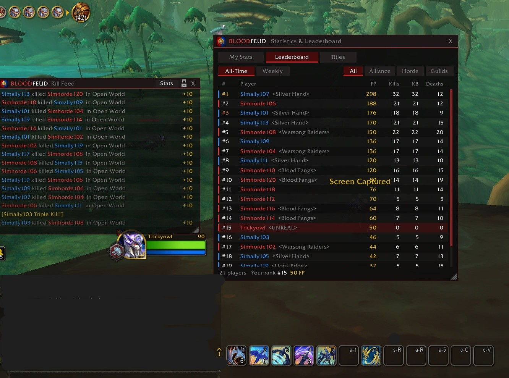
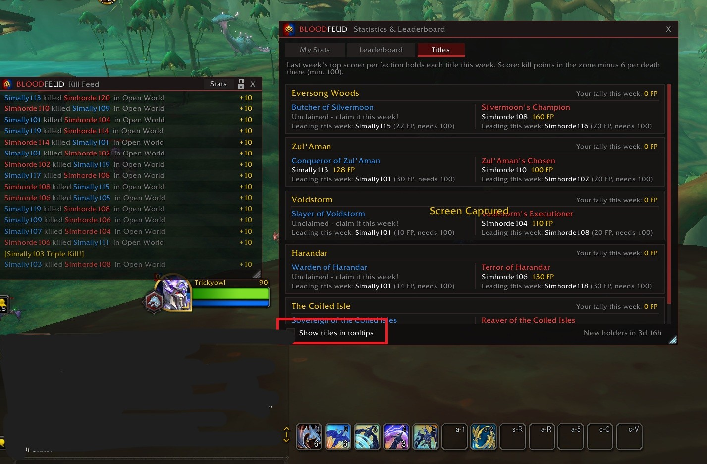
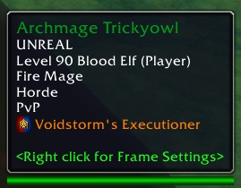
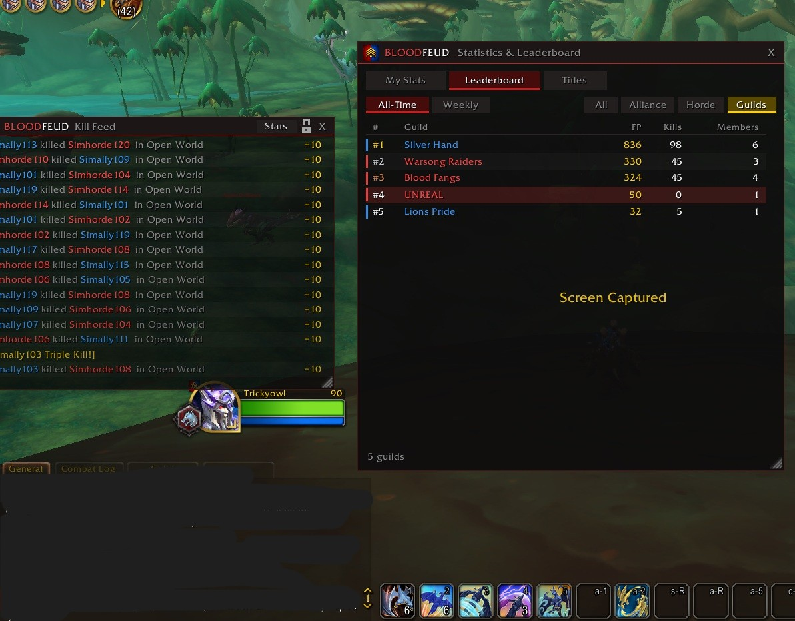

# Bloodfeud

Bloodfeud turns open-world PvP in World of Warcraft into a competition. Every kill between Bloodfeud players shows up in a live kill feed and counts toward a shared leaderboard that everyone sees the same way.

Available for **retail (Midnight)** and **WoW Forever**.

> **Alpha:** Bloodfeud is still in early testing. If something looks wrong, please open an [issue](../../issues).

## Download and install

1. Go to the [latest release](../../releases/latest).
2. Download the zip for your game:
   - **Bloodfeud.v.X.zip** for retail
   - **BloodfeudForever.v.X.zip** for WoW Forever
3. Extract it into your game's `Interface\AddOns` folder, for example
   `World of Warcraft\_retail_\Interface\AddOns` for retail.
   You should end up with an `AddOns\Bloodfeud` (or `AddOns\BloodfeudForever`) folder.
4. Restart the game or type `/reload`.

To update, delete the old folder and extract the new zip the same way. Your points are not stored in the addon folder and won't be lost.

## How it works

Hunt enemy-faction players in the open world to earn Faction Points (FP). A kill only counts when both you and your victim use Bloodfeud, so spread the word and bring your friends.

Everyone starts with 50 FP. You only lose points when you die, and each death to another Bloodfeud player costs 6 FP.

A same-level kill is worth 10 FP. Taking down someone higher level pays more, up to 15 FP. Picking on lower-level players pays less, and anyone 4 or more levels below you is worth nothing at all.

Fighting together? Points are never split. Everyone who took part gets the full reward, adjusted by group size: 100% solo, 90% for two players, 80% for three, and 50% for four or more. Only party members who were actually fighting count.

## Zone titles

Each week, every featured zone has two titles up for grabs, one for the Alliance and one for the Horde. Earn the most points in a zone (kills there, minus your deaths there) and you hold its title for the whole following week. You need at least 100 points in a zone to claim it.

Title holders show their title in their tooltip for every Bloodfeud player to see. Hold more than one? Pick the one you want to show off.

| Retail zone | Alliance | Horde |
|---|---|---|
| Eversong Woods | Butcher of Silvermoon | Silvermoon's Champion |
| Zul'Aman | Conqueror of Zul'Aman | Zul'Aman's Chosen |
| Voidstorm | Slayer of Voidstorm | Voidstorm's Executioner |
| Harandar | Warden of Harandar | Terror of Harandar |
| Coiled Isles | Sovereign of the Coiled Isles | Reaver of the Coiled Isles |

| Forever zone | Alliance | Horde |
|---|---|---|
| Stranglethorn Vale | Terror of Stranglethorn | Stranglethorn's Headhunter |
| Hillsbrad Foothills | Avenger of Southshore | Reaper of Tarren Mill |
| Ashenvale | Sentinel of Ashenvale | Warsong Ravager |
| Arathi Highlands | Shield of Stromgarde | Fury of Hammerfall |
| Orgrimmar | Bane of Orgrimmar | Defender of Orgrimmar |
| Stormwind City | Defender of Stormwind | Bane of Stormwind |

## Kill streaks

Chain killing blows to light up the feed: Triple Kill, PENTAKILL, RAMPAGE and GODLIKE. Your streak ends when you die.

## Leaderboard and stats

Compete on the All-Time and Weekly rankings, and filter by Alliance, Horde or Guilds. Your own stats page shows your rank, points, kills, killing blows, deaths, K/D and your recent fights, for all time and for this week.

## Fair play

A kill needs confirmation from both sides, and fake kills are detected and thrown out. Editing your own files only changes your own screen. If you were offline, you catch up on missed kills automatically when you log in.

Bloodfeud only tracks the open world. Dungeons, raids, battlegrounds and arenas don't count.

## Commands

| Command | What it does |
|---|---|
| `/bf` | Open or close the kill feed (`/bff` also works in Forever) |
| `/bf stats` | Your stats, the leaderboard and titles |
| `/bf titles` | Turn titles in tooltips on or off |
| `/bf sync` | Grab missed kills right away |
| `/bf help` | List all commands |

You can also use the minimap button: left-click for the kill feed, right-click for stats. The windows can be moved, resized and locked.

## Good to know

Bloodfeud gets better the more people use it. With only a few players, some kills from the other faction may take a little longer to show up.

## License

Copyright © 2026 Yiğit Boyacıoğlu ("Trickyowl").

Bloodfeud is licensed under [Creative Commons Attribution-NoDerivatives 4.0](https://creativecommons.org/licenses/by-nd/4.0/) (see [LICENSE](LICENSE)). You are welcome to download, use and share Bloodfeud, as long as you credit the author and share it unmodified. Modified versions may not be shared. Bug reports and suggestions are always welcome through [issues](../../issues).

## Contact

Created by "Trickyowl" Yiğit Boyacıoğlu, trickykoowl@gmail.com
